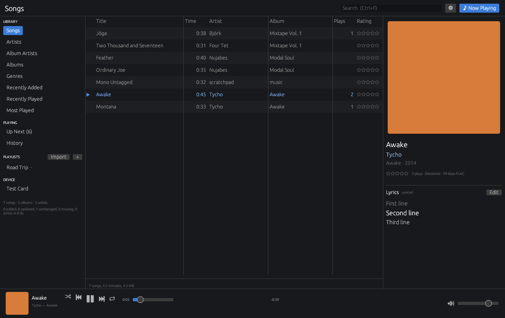

# Yerg (Yet anothER vibe-coded music player, oh Great) Library

A lightweight, cross-platform music library and player written in Rust.



* Library views by song, artist, album artist, album, genre, recently added,
  recently played and most played, with sortable columns, search, ratings,
  play counts and skip counts. Collaborations ("A & B", "A, B", "A feat. B",
  multi-value ARTIST and ARTISTS tags) are listed under each of their
  artists, while names such as Tyler, the Creator or Earth, Wind & Fire stay
  whole (`crates/yerg-core/src/artists.rs`; own exceptions in Settings ›
  Library).
* Playlists (drag-free reorder via context menu, M3U import/export, pick
  which ones go on the player).
* Tags read and written for MP3, FLAC, Ogg/Opus, M4A/AAC, WAV, AIFF, APE and
  WavPack (via `lofty`), album art embedded or from folder images, lyrics
  embedded or from `.lrc`/`.txt` sidecars with synced highlighting.
* Playback with seek, shuffle, repeat, "play next" and an Up Next panel
  (button at the right of the transport bar) that reorders by drag and drop.
  Both side panels can be hidden from the top bar.
  Audio is decoded with `symphonia` and converted to the output device's
  own sample rate and channel count (windowed-sinc resampling via `rubato`,
  proper surround downmix, stereo averaged for mono headsets), then played
  through `cpal` (WASAPI, CoreAudio, ALSA/PulseAudio/PipeWire). Pick an
  output in Settings › Playback or follow the system default; the player
  follows default-device changes and reconnects when a device disappears,
  carrying on from the same position.
* Scrobbling to Last.fm, ListenBrainz and Libre.fm. Every listen is stored locally
  first; offline listens and listens imported from the MP3 player are
  submitted later with their original timestamps.
* Device sync: copies tracks to the card unchanged, in their original
  format, writes the `INDEX.BIN` offset tables the firmware loads into RAM,
  mirrors playlists, and imports the player's `LISTENS.LOG` into play
  history. Format spec in [docs/DEVICE_FORMAT.md](docs/DEVICE_FORMAT.md); a C
  loader for the firmware is in [firmware/yerg_index.h](firmware/yerg_index.h).
  The player page is hidden in the app for now (`SHOW_DEVICE` in
  `crates/yerg-app/src/app.rs`); the `yerg device` commands still work.

## Layout

| crate | what |
|-------|------|
| `yerg-core` | SQLite library, scanning, tags, art, lyrics, playlists, play history, settings |
| `yerg-player` | audio engine (dedicated thread, commands + state snapshot) |
| `yerg-scrobble` | Last.fm and ListenBrainz clients, offline queue worker |
| `yerg-sync` | device index format, ASCII/FAT naming, file copy, listen log import |
| `yerg-app` | the desktop app (`egui`/`eframe`) — binary `yerg-library` |
| `yerg-cli` | command line front end — binary `yerg` |

## Building

Install Rust with [rustup](https://rustup.rs) (no virtual environment needed:
dependencies are pinned per project in `Cargo.lock` and built into `target/`).

```bash
cargo build --release
```

Binaries land in `target/release/`: `yerg-library` (GUI) and `yerg` (CLI).

Platform notes:

* **Windows**: needs the Visual Studio C++ build tools (for the MSVC linker
  and the bundled SQLite). Nothing else.
* **macOS**: Xcode command line tools. Works on Intel and Apple Silicon.
* **Linux** (x86_64 and aarch64, e.g. Raspberry Pi):
  `sudo apt install build-essential pkg-config libasound2-dev libgtk-3-dev libxkbcommon-dev libwayland-dev libxcb-render0-dev libxcb-shape0-dev libxcb-xfixes0-dev libssl-dev`
  (ALSA for audio output, GTK for the file dialogs, the rest for the window).

Every dependency is pure Rust or bundles its own C sources, so there are no
runtime libraries to ship.

## Using the app

1. First run opens Settings › Library: add your music folder(s). Scanning is
   incremental afterwards (files are re-read only when size or mtime changed);
   use "Full rescan" after retagging outside the app.
2. Double-click plays; right-click a track for Play Next, playlists, rating,
   tag editing, Go to Artist/Album, Show in Folder. Shift/Ctrl-click to
   multi-select, Delete removes from a playlist, Space toggles playback,
   Ctrl+←/→ skip, Ctrl+F searches.
3. The ♪ Now Playing panel shows art, rating and lyrics; click a synced lyric
   line to seek there. "Edit" opens the tag editor, where lyrics (plain or
   LRC) and cover art can be set and optionally written back to the file.
4. Settings › Scrobbling: Last.fm needs your own API key and secret
   (last.fm/api/account/create), then Connect opens the approval page and
   Finish stores the session. ListenBrainz needs only the user token.
   Libre.fm needs no API account: Connect opens libre.fm to approve the app.
   Waiting listens are shown for each connected service and can be submitted,
   skipped or requeued. Listens from before Libre.fm was added start as
   skipped for it (`yerg scrobble requeue librefm` sends them anyway).
5. The player page (hidden for now) registers the SD card (pick its drive/folder), chooses
   whole library or selected playlists, previews the sync, runs it with
   progress and a log, and imports listens from `LISTENS.LOG`.

The library database lives in the per-user data directory (override with
`YERG_DATA_DIR`), e.g. `%APPDATA%\yerg\YergLibrary\data\library.db` on
Windows.

If the app ever stops on its own, the error (message, source line and
backtrace) is appended to `crash.log` in the same folder, and the next start
says so. Settings › About has buttons to open it. A start after the app was
killed or lost power also shows a notice. `YERG_DEBUG_PANIC=1` triggers a
test crash.

## Theming (dotfiles)

The look lives in plain-text files you edit, keep in a dotfiles repo and
share, like ricing a Linux desktop. Saved changes apply immediately.

```
~/.config/yerg/          (%APPDATA%\yerg on Windows; override with YERG_CONFIG_DIR)
  yerg.toml              theme, fonts, sizes, icons, colour overrides
  themes/<name>.toml     colour schemes
  icons/<name>.svg|png   replacement icons
```

* `theme = "nord"` picks `themes/nord.toml`. Default, light, gruvbox, nord,
  catppuccin-mocha and dracula are written on first run. `theme = "wal"`
  uses pywal's `~/.cache/wal/colors.json`.
* `import = [...]` loads more files in order. Later ones win, and
  `yerg.toml`'s own `[colors]`, `[font]` and `[icons]` win last.
* `[colors]` has 23 roles (background, text, accent, selection, stars, link,
  and so on) as `#rrggbb`. A theme can set just a few of them.
* `[font]` takes an installed `family` or a `file`, sizes for body, small,
  heading and monospace text, and `scale` to zoom the whole interface.
* `[icons]` takes `size`, a `folder` of replacements named `play.svg`,
  `queue.png` and so on (tinted with the theme unless `tint = false`), or
  `[icons.glyphs]` drawn with an icon `font` such as a Nerd Font.
* Mistakes such as a misspelt key, a bad colour or a missing font are listed
  in Settings › Appearance, with a suggestion where possible. Everything
  else in the file still applies. That tab also switches themes (editing
  `yerg.toml` in place), lists installed fonts and shows the icon names.

## Command line

```bash
yerg folders add ~/Music
yerg scan
yerg tracks --sort play-count --desc
yerg albums
yerg playlist create "Road Trip" && yerg playlist add 1 12 34 56
yerg device add E:/ --name Yerg          # register the card
yerg device plan <id> && yerg device sync <id>
yerg device import <id>                  # listens from the player
yerg index build out.bin && yerg index dump out.bin
yerg scrobble lastfm-auth --api-key KEY --api-secret SECRET
yerg scrobble listenbrainz TOKEN
yerg scrobble librefm-auth
yerg scrobble flush
```

`--db PATH` points any command at another library (handy for tests).

## Play counting

A play is recorded when half the track or four minutes has played, for tracks
longer than 30 seconds (Last.fm's rule). Each play row remembers where it came
from (app, player, import), whether its timestamp was estimated, and its
submission state per service (waiting, sent, ignored, skipped).

## Tests

```bash
cargo test --workspace
```

Covers the database, tag fallbacks, LRC parsing, play rules, Last.fm signing
and response parsing, the index round-trip and checksum, FAT-safe naming,
copying files to the card, audio output conversion, the listen log parser,
timestamp estimation, device registration, sync planning and listen import.
